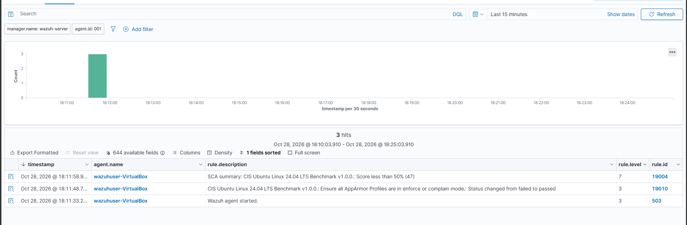
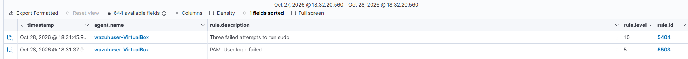
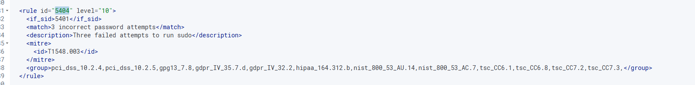

# Learning Events

* Finding events it is in Threat Hunting > Events
*  I am able to see events such as when I used sudo on the client for the first time or when a PAM session opens.


Let us get the last 15 minutes of events the agent pulled from the client

Top Right corner is where I filtered the time to last 15 minutes and here is what we have


### First excercise: Multiple incorrect passwords for Sudo

Test: 

Let us run 3 incorrect password attempts on our wazuh user 



Result: 

We generated a authentication failure 3 times via running sudo 

Observing the generated event here is what we get

* rule.id = 5404
* rule.level = 10 (Medium risk)
* agent.ip = 10.0.0.197
* agent.name = 	wazuhuser-VirtualBox

Analysis:

We can see that this is generated by our own client by the agent ip and agent name we can see it generated the password failures. 

We know the cause of this is that I intentionally entered the password incorrectly for privilged escalation

Multiple password failures can occur on a daily basis from user error trying to authenticate to get authorized but it is a good practice to always stay mindful to watch for patterns.


What does Rule 5404 actually do? Let us check in the XML file for syslog rules 



We discover that it refers to a parent rule ID 5401. 5401 is for when there is a failed password attempt on sudo

Reading this in plain english for the following rule

If 5401 is met then match and if the log contains `3 incorrect password attempts` Then 5404 is triggered with level 10 severity 

For 5401 to be met it relies on 5400 being met and the log containing `incorrect password attempt` . If both these conditions are satisfied then 5401 is triggered with a severity of 5

For 5400 to be met a syslog must contain the word `sudo`

### Understanding how wazuh-logtest decodes

Next is to view how decoding works when we pass wazuh a log

```
sudo /var/ossec/bin/wazuh-logtest
```

We will run this command and pass a log in that causes 3 failed sudo password attempts

```
Starting wazuh-logtest v4.14.9
Type one log per line

Oct 28 23:31:45 wazuhuser-VirtualBox sudo[4746]: wazuhuser : 3 incorrect password attempts ; TTY=pts/0 ; PWD=/home/wazuhuser ; USER=root ; COMMAND=/usr/bin/ls
```

Here we pass in a log that was close to our previous example. and this is the output we get:

```
**Phase 1: Completed pre-decoding.
        full event: 'Oct 28 23:31:45 wazuhuser-VirtualBox sudo[4746]: wazuhuser : 3 incorrect password attempts ; TTY=pts/0 ; PWD=/home/wazuhuser ; USER=root ; COMMAND=/usr/bin/ls'
        timestamp: 'Oct 28 23:31:45'
        hostname: 'wazuhuser-VirtualBox'
        program_name: 'sudo'

**Phase 2: Completed decoding.
        name: 'sudo'
        parent: 'sudo'
        ftscomment: 'First time user executed the sudo command'
        command: '/usr/bin/ls'
        dstuser: 'root'
        pwd: '/home/wazuhuser'
        srcuser: 'wazuhuser'
        tty: 'pts/0'

**Phase 3: Completed filtering (rules).
        id: '5404'
        level: '10'
        description: 'Three failed attempts to run sudo'
        groups: '['syslog', 'sudo']'
        firedtimes: '1'
        gdpr: '['IV_35.7.d', 'IV_32.2']'
        gpg13: '['7.8']'
        hipaa: '['164.312.b']'
        mail: 'False'
        mitre.id: '['T1548.003']'
        mitre.tactic: '['Privilege Escalation', 'Defense Evasion']'
        mitre.technique: '['Sudo and Sudo Caching']'
        nist_800_53: '['AU.14', 'AC.7']'
        pci_dss: '['10.2.4', '10.2.5']'
        tsc: '['CC6.1', 'CC6.8', 'CC7.2', 'CC7.3']'
**Alert to be generated.

```

We see that Wazuh has 3 stages (pre-decoding, completed decoding and completed rule filtering) that get more and more precise by adding key-value pairs at each step.

I assume it does this because it has a specific input layout that it uses to map the log to one of the rules in the XML file.

We see that we end up getting the same rule ID of 5404. This is because Wazuh was able to identify that `sudo` was included in the log, which satisfies rule 5400.

Then it matches `incorrect password attempt` because that text is contained within the original log message: `wazuhuser : 3 incorrect password attempts`. Since rule 5400 was already matched, this allows rule 5401 to match as well.

Finally, since rule 5401 has matched and the original log also contains `3 incorrect password attempts`, rule 5404 is able to fire.
