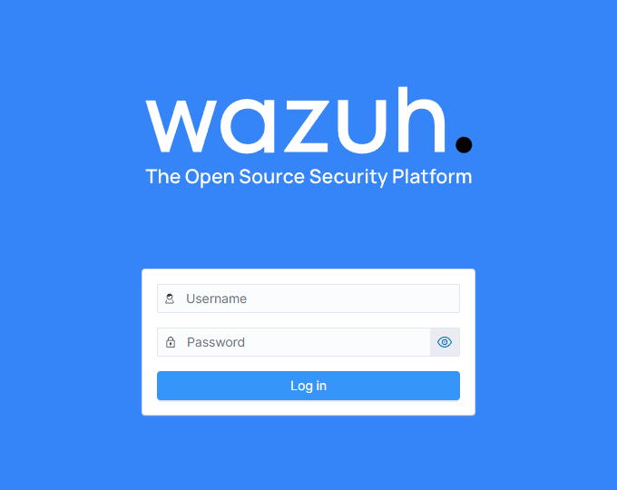
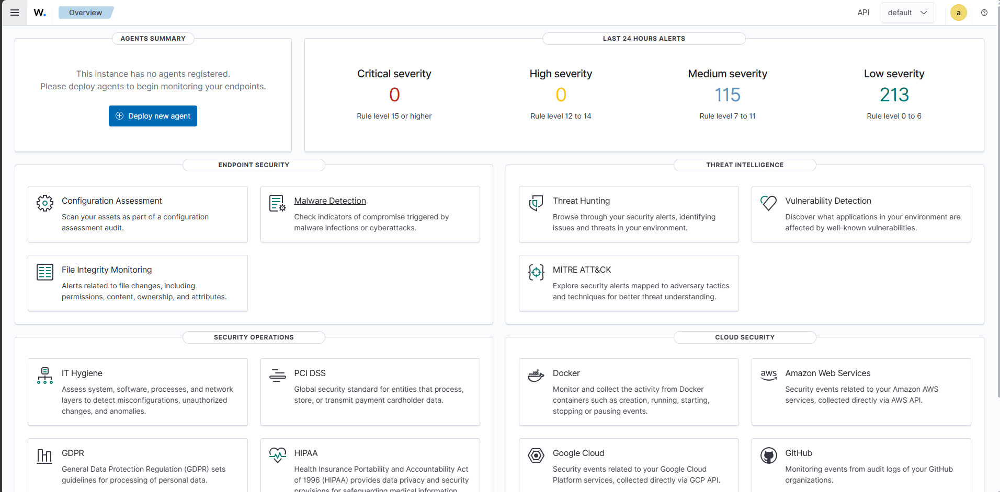
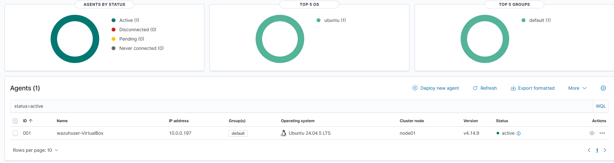
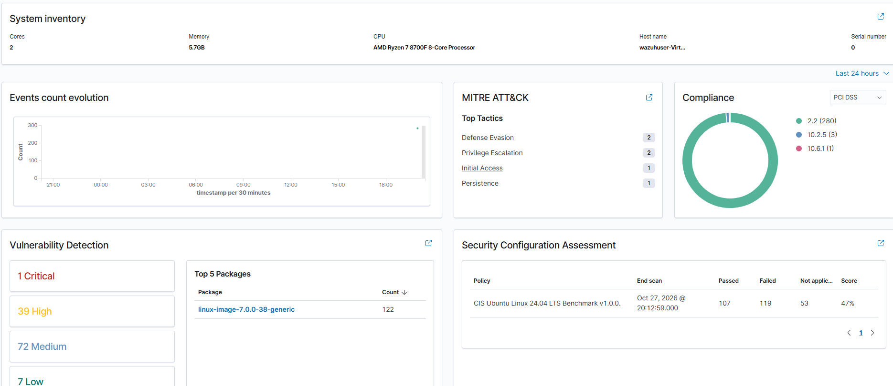
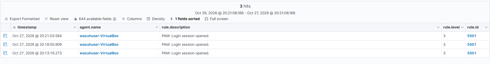

### Installation steps taken

* Followed the documentation online the official Wazuh page 
* Found that I needed to install a linux version suitable for running Wazuh
* Installed virtual box along with an up to date linux iso (Ubuntu 24.04)

* Configured Virtual Machine to be sufficent enough to run a clean enviroment allocating enough resources for the VM


### Running Process

* Got the server online for Wazuh was able to ping but had NAT on as a setting for the network setting. Changed to Bridged adapter to view the dashboard on my host

* 

Was able to succesfully get the server page to work 



### Setting up the agent

We will now get started to attaching an agent to a host


We will use ubuntu 24.04 for our Host on Virtual box as well 


Ubuntu client is now set up now it is time to set up the agent on the machine following the documentation online for APT linux

After installing the agent on the Host we run these 3 commands
to make sure we can get the wazuh-agent up and running
```
systemctl daemon-reload
systemctl enable wazuh-agent
systemctl start wazuh-agent
```



Success! We have now got an agent up and running

We can now see the in detail dashboard of the Host



When we traverse into threat hunting and events we can see that when we have ran sudo after the agent has been installed there was 3 successes


